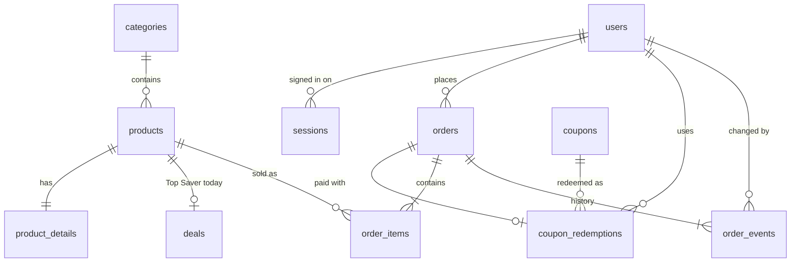

# Database design: PostgreSQL for the MVP

The MVP's database, moving from SQLite (`src/server/db/schema.ts` today) to PostgreSQL on Supabase, written as a
Drizzle schema in Phase 1. The plan is in [`PLAN.md`](../PLAN.md); how Supabase is set up is in
[`supabase-guide.md`](supabase-guide.md).

## Rules that hold everywhere

- **Money is integer cents** (`integer`, column names end in `_cents`), converted to dollars only at the API edge, as
  today. Never `numeric` floats in the app, never prices from the browser.
- **Time is `timestamptz`**, stored in UTC; the store's time zone (`Asia/Bangkok`) is a setting, used for "today"
  (Top Saver window, sales summary).
- **IDs:** catalog rows keep their readable text ids (`bs5`, `fruits-vegetables`) so URLs, seed data and tests don't
  change. Users, sessions and orders use `uuid` (`gen_random_uuid()`), which can't be guessed or counted. Orders also
  get a short human number (`FM-000123`) for the customer and the admin.
- **Enums are Postgres enums** (`order_status`, `user_role`, …), so a typo can't be stored.
- **Constraints encode the rules** (`CHECK`, `UNIQUE`, foreign keys), so bad data is refused by the database even if
  the code has a bug, the same approach as today.
- **Snapshots on orders:** an order copies the product name, unit price and the delivery address at the time of
  purchase. Later price or name changes never rewrite history.
- **Row Level Security (RLS) is enabled on every table with no policies.** The app connects as the database owner
  from the server, which bypasses RLS; Supabase's public Data API (which uses the `anon` key) then sees nothing. See
  the Supabase guide › "Why RLS matters even with our own auth".

## Diagram

## Catalog (exists today; ported, with small additions)

| Table | Columns | Changes from SQLite |
|---|---|---|
| `categories` | `slug` text PK, `name` text unique, `image` text, `position` int, `featured` boolean | `featured` becomes a real boolean |
| `products` | `id` text PK, `brand`, `name`, `category_slug` → categories, `unit`, `price_cents` int > 0, `old_price_cents` int null (> price), `rating` numeric(2,1) 0–5, `reviews` int, `image`, `stock` int ≥ 0, `sold_week`, `sold_month` int, `is_active` boolean default true, `created_at`, `updated_at` timestamptz | **New:** `is_active` (admin hides a product without deleting order history), `updated_at`. Indexes as today plus a trigram index on `name`/`brand` for search (`pg_trgm`) |
| `product_details` | `product_id` PK → products (cascade), `description`, `origin`, `storage`, `highlights` text[] | `highlights` becomes a native array instead of JSON text |
| `deals` | `product_id` PK → products (cascade), `sold` int ≥ 0 | unchanged |
| `banners` | `id` text PK, `placement` enum (hero, hero-side, promo, brand), copy fields, `image`, `image_alt`, `href`, `cta_label`, `position`, `starts_at`, `ends_at` timestamptz | `placement` becomes an enum; times become `timestamptz` |
| `settings` | `key` text PK, `value` text | unchanged: `free_delivery_from_cents`, `delivery_fee_cents`, `member_discount_percent`, `time_zone`, plus **new** `promptpay_id` (the shop's PromptPay phone or tax id) |

## Accounts (Phase 2)

| Table | Columns | Notes |
|---|---|---|
| `users` | `id` uuid PK, `email` text unique (stored lower-case), `password_hash` text, `name` text, `phone` text null, `role` enum `customer`/`admin` default `customer`, `created_at` | `password_hash` is argon2id (it contains its own salt and parameters). Unique index on `lower(email)` |
| `sessions` | `id` text PK (**SHA-256 of the token**, never the token), `user_id` → users (cascade), `created_at`, `expires_at`, `last_seen_at`, `user_agent` text null | A stolen database dump can't be replayed as cookies. Sign-out deletes the row; an index on `expires_at` lets a job delete expired sessions |
| `rate_limits` | `key` text, `window_start` timestamptz, `count` int; PK (`key`, `window_start`) | Keys like `login:ip:1.2.3.4`, `login:email:a@b.c`. Serverless functions share no memory, so the counter must live in the database |

## Coupons (Phase 2–3)

| Table | Columns | Notes |
|---|---|---|
| `coupons` | `code` text PK, `type` enum `percent`/`fixed`, `value` int (percent 1–100, or cents), `description`, `min_spend_cents` int null, `max_discount_cents` int null, `members_only` boolean, `starts_at`, `expires_at` null, `is_active` boolean | `WELCOME15` is seeded: 15%, members only, once per user |
| `coupon_redemptions` | `id` uuid PK, `coupon_code` → coupons, `user_id` → users, `order_id` → orders unique, `created_at`; **unique (`coupon_code`, `user_id`)** | Every MVP coupon is once per user, so the index covers them all (a reusable coupon later would need its own rule). It makes "only once" true even if two orders are placed at the same moment. Cancelling an unpaid order deletes its redemption so the coupon can be used again |

## Orders (Phase 3)

| Table | Columns | Notes |
|---|---|---|
| `orders` | `id` uuid PK, `number` bigint identity (shown as `FM-000123`), `user_id` → users, `status` enum, `payment_method` enum (`promptpay`), `subtotal_cents`, `product_discount_cents`, `coupon_discount_cents`, `delivery_cents`, `total_cents`, `coupon_code` null, address snapshot (`recipient`, `phone`, `line1`, `line2`, `city`, `postal_code`), `note` null, `idempotency_key` uuid, `created_at`, `paid_at`, `cancelled_at`, `delivered_at` | **Unique (`user_id`, `idempotency_key`)**: a retried checkout returns the first order. `CHECK (total_cents = subtotal_cents - product_discount_cents - coupon_discount_cents + delivery_cents)` |
| `order_items` | `order_id` → orders (cascade), `product_id` → products, `product_name`, `unit` , `image`, `unit_price_cents`, `old_price_cents` null, `qty` int 1–99, `line_total_cents`; PK (`order_id`, `product_id`) | Snapshot of what was bought, at that price |
| `order_events` | `id` bigint identity PK, `order_id` → orders (cascade), `status` enum, `actor_user_id` → users null, `note` null, `created_at` | One row per status change: the timeline on the order page and the admin's audit trail |

`order_status`: `awaiting_payment` → `paid` → `packing` → `out_for_delivery` → `delivered`, or `cancelled` from
`awaiting_payment` (customer or admin) and from `paid`/`packing` (admin only). The allowed moves live in one function in
`src/server/`, tested on their own.

### Placing an order safely (one transaction)

1. Re-read every product (`is_active`, current price) for the ids and quantities sent; the browser's prices are ignored.
2. `UPDATE products SET stock = stock - $qty WHERE id = $id AND stock >= $qty` for each line. A line that updates no
   row is out of stock: roll back and answer `OUT_OF_STOCK` with the lines that failed. This can't oversell, even with
   two checkouts at once, without locking whole tables.
3. Check the coupon (active, dates, min spend, members only) and insert `coupon_redemptions`; the unique index
   refuses a second use.
4. Insert `orders` (status `awaiting_payment`), `order_items`, the first `order_events` row; `sold_week`/`sold_month`
   are updated when the order is paid.
5. Commit. A retry with the same `Idempotency-Key` finds the existing order and returns it.

Cancelling puts the stock back and deletes the coupon redemption, in one transaction.

## Migrations and environments

- The Drizzle schema (`src/server/db/schema.ts`) is the source of truth; `drizzle-kit generate` writes SQL files to
  `drizzle/` that are reviewed and committed. Never change a migration that has run in production: add a new one.
- Extras Drizzle doesn't model (the `pg_trgm` extension, `ENABLE ROW LEVEL SECURITY`, the totals `CHECK`) go in a
  hand-written migration next to the generated ones.
- **Local and CI:** tests run on PGlite (Postgres in WebAssembly) with the same migrations, so they need no Docker and
  no network. Development uses either a local Postgres (Supabase CLI with Docker, or any Postgres 15+) or a separate
  Supabase "dev" project; never the production database.
- **Production:** `npm run db:migrate` runs the migrations against Supabase. The seed (`npm run db:seed`) loads the
  starting catalog once; after launch, the admin dashboard owns the catalog and the seed is only for development.
